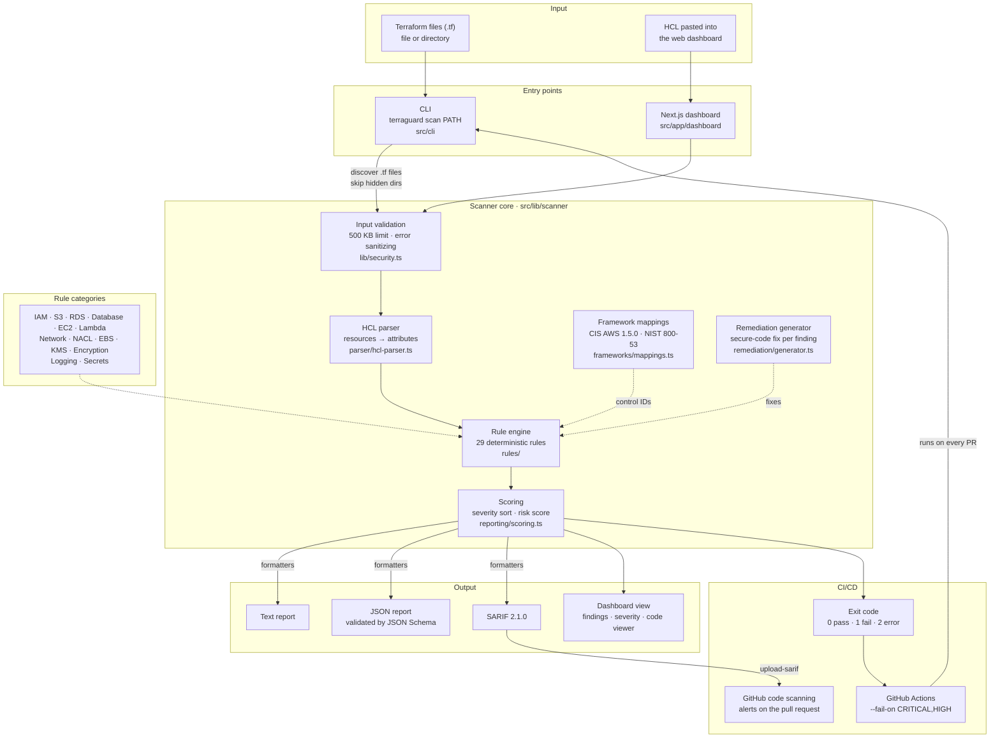

# TerraGuard

**Deterministic Infrastructure-as-Code Security Scanner for Terraform**

---

## Overview

TerraGuard is a **fast, deterministic, and secure** static analysis tool that scans Terraform configurations for security vulnerabilities, compliance violations, and misconfigurations.

Unlike AI-powered tools, TerraGuard uses **deterministic rule-based detection** to provide:
- ✅ **Reproducible results** — same input always produces same output
- ✅ **Zero false positives** on secure configurations
- ✅ **Instant scans** — 100KB in ~270ms
- ✅ **No external APIs** — runs 100% locally, no data leakage
- ✅ **CI/CD ready** — JSON, SARIF, and configurable failure thresholds

**TerraGuard is not a toy.** It's a production-ready security scanner built with defense-in-depth architecture, comprehensive testing (230 tests), and professional documentation.

---

## Problem

Infrastructure-as-Code (IaC) has revolutionized cloud deployment, but it has also introduced a new attack surface: **misconfigured infrastructure**.

A single line of Terraform can expose:
- 🔓 Public S3 buckets with sensitive data
- 🔓 SSH/RDP ports open to the internet
- 🔓 Unencrypted databases with hardcoded passwords
- 🔓 Overly permissive IAM policies

Traditional security tools are:
- **Slow** — take minutes to scan large codebases
- **Noisy** — generate hundreds of false positives
- **Expensive** — require cloud API access or paid subscriptions
- **Non-deterministic** — produce different results on each run

**TerraGuard solves this.**

---

## Why IaC Security Matters

### The Cloud Security Crisis
- **80%** of cloud breaches are caused by customer misconfigurations (Gartner)
- **$4.45M** — average cost of a data breach in 2023 (IBM)
- **93%** of organizations have cloud misconfigurations (Orca Security)

### The Shift-Left Imperative
Security must move **left** — into the development process, not after deployment.

TerraGuard enables:
- **Pre-commit hooks** — catch issues before code is pushed
- **Pull request gates** — block merges with critical findings
- **CI/CD integration** — automated security in every pipeline
- **Developer education** — inline remediation guidance

---

## Architecture

TerraGuard has one scanner core and two front ends. The **CLI** scans files and directories for CI/CD. The **Next.js dashboard** scans pasted HCL in the browser. Both call the same `scanTerraformCode()` function, so a file gets identical findings wherever it's scanned. Nothing leaves the machine: there are no external API calls.

### Core Components

| Component | Path | Purpose |
|-----------|------|---------|
| **CLI** | `src/cli/` | Argument parsing, recursive `.tf` discovery, `--format` and `--fail-on`, exit codes for CI |
| **Input validation** | `src/lib/security.ts` | 500 KB input limit, type checks, sanitized error messages |
| **HCL parser** | `src/lib/scanner/parser/` | Turns Terraform text into resources and attributes. Never executes or evaluates Terraform |
| **Rule engine** | `src/lib/scanner/rules/` | 29 isolated rules in 11 categories, each a pure function on one resource |
| **Framework mappings** | `src/lib/scanner/frameworks/` | Maps each rule to CIS AWS Foundations 1.5.0 and NIST 800-53 controls |
| **Remediation** | `src/lib/scanner/remediation/` | Explanation, impact and a secure Terraform example for every finding |
| **Scoring** | `src/lib/scanner/reporting/` | Deterministic sort (file → line → rule → severity) and risk score |
| **Formatters** | `src/cli/formatters/` | Text, JSON (schema in `schemas/`) and SARIF 2.1.0 output |
| **Dashboard** | `src/app/`, `src/components/` | Monaco editor, severity breakdown, finding details. Runs on the same scanner core |
| **CI workflows** | `.github/workflows/` | Lint → tests → dependency scan, plus the TerraGuard SARIF scan |

### Scan flow

1. **Discover**: the CLI collects `.tf` files from the target path, skipping hidden directories such as `.terraform`.
2. **Validate**: each file is checked against the 500 KB limit before parsing.
3. **Parse**: the HCL parser extracts every `resource` block and its attributes.
4. **Evaluate**: every rule runs against every resource. A match becomes a finding with its file, line, severity, framework controls and fix.
5. **Score and sort**: findings are sorted deterministically and rolled up into a risk score and per-severity counts.
6. **Report**: output goes out as text, JSON or SARIF. With `--fail-on`, any finding at a listed severity returns exit code 1 and fails the pipeline.
